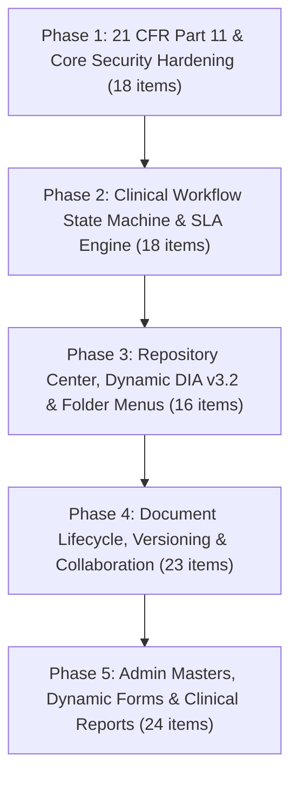

# Design: Phase-Wise Implementation of 99 Partially Implemented eTMF Capabilities

## Context & Objectives
The forensic code-level audit against the **Clinevo Electronic Trial Master File (eTMF) 4.3 User Guide (Version 4.4)** evaluated 216 capabilities across 17 categories. 
While 7 capabilities are fully implemented (3.2%) and 110 are missing (50.9%), **99 capabilities (45.8%) are currently partially implemented**. 

These partially implemented features represent areas where foundational routing, database schema columns, or UI components exist, but critical regulatory controls, complete state machine logic, clinical validation, or full end-to-end integration are missing.

This design structures the implementation of all 99 partially implemented capabilities into **5 sequential, risk-prioritized phases**.

## Core Architectural Trade-offs & Analysis

1. **Foundational Security First vs. Feature Breadth**:
   - *Trade-off*: Should we build visible features (UI, folders, reports) first or 21 CFR Part 11 security controls?
   - *Decision*: Foundational security and regulatory controls (dual-component auth, binary SHA-256 digest hashing, session timeouts, PDF rendition) must precede workflow and document actions. In clinical trials, any document processed through a non-Part 11 compliant workflow produces invalid, non-tamper-evident regulatory records that would fail FDA/EMA inspection.

2. **In-Process PDF Manipulation vs. External Microservice**:
   - *Trade-off*: Should PDF rendition (cover pages, signature manifests, watermarks) run via a separate worker process or in-process via Node.js?
   - *Decision*: In-process using `pdf-lib` in Node.js. It requires zero additional infrastructure, adds minimal latency (<150ms per document), produces pure deterministic vector/text overlays without headless browser overhead, and keeps the local server architecture straightforward.

3. **Database-Driven DIA Model vs. Static Array**:
   - *Trade-off*: Should `FolderTree.jsx` continue using hardcoded `DIA_TMF_ZONES` or pull dynamically from the database?
   - *Decision*: Migrate to dynamic hierarchy backed by `dia_model_items` with a local caching fallback. This unlocks Study → Country → Site branching and dynamic 6-metric status badges without regressing current folder navigation.

---

## The 5-Phase Roadmap Breakdown

### Phase 1: 21 CFR Part 11 Compliance & Core Security Hardening (18 capabilities)
- Dual-component e-signature re-authentication (User ID + Password).
- Streaming SHA-256 binary file hashing on upload and cryptographic binding to signature records.
- Server-side PDF rendition engine (`pdf-lib`) for dynamic Cover Pages, Signature Manifests, and Watermarks.
- Password policy enforcement (length, complexity, expiry, reuse history, first-time mandatory reset).
- Account lockout after consecutive failed attempts (`LOGIN_ATTEMPTS`).
- Configurable inactivity session timeout (`USER_SESSION_TIMEOUT`) in frontend and backend.
- Dynamic tenant context derivation from JWT claims (removing hardcoded `tenant-001`).

### Phase 2: Complete Clinical Workflow State Machine & Task Grid SLA Engine (18 capabilities)
- Implement clinical lifecycle states (`Under Review`, `Review Rejected`, `Approve Rejected`, `Pending Signoff`, `Signed Off`, `Pending Publish`, `Published`).
- Segregation of duties: strictly prevent Author from self-reviewing or self-approving their own uploads.
- Configurable workflow archetypes (AutoPublish, All Reviewers, Only Review, Only Approve).
- Task Grid lifecycle tabs (Documents open states, Expiry Documents, Queries).
- SLA color-coded badges (RED overdue, YELLOW due soon, GREEN on track) and due date calculations.

### Phase 3: Repository Center, Dynamic DIA v3.2 & Folder Operations (16 capabilities)
- Dynamic repository tree populated from `dia_model_items` API.
- 3-tier hierarchy: Study → Country → Site folder branching.
- 6-metric status counters per folder node (*Total, Completed, In Progress, In QC, Missing, Expected*).
- Folder Context Menu (Assign user group, Lock study, Export, Pin/Unpin, Properties).
- Folder Action Menu (File Plan EDL resync, Milestone due dates, Add placeholder with justification, Batch upload classifier).

### Phase 4: Document Lifecycle, Versioning & Collaboration Controls (23 capabilities)
- Check-Out version locking and Check-In target status advancement.
- True document blinding and unblinding with role-based access masks.
- Sticky notes (note-to-file) modal and backend persistence.
- Document annotation reply threads and resolution tracking.
- Document Copy and Move log audit records.
- Access history tracking (viewing and downloading events recorded in audit log).

### Phase 5: Administration Masters, Dynamic Forms Runtime & Clinical Reports Suite (24 capabilities)
- In-use deletion protection for Department, Designation, and Document Type masters.
- Organization Profile settings persistence and runtime enforcement.
- Dynamic Forms/Logs record entry, locking, freezing, and PDF push to DIA folder.
- 19 Standard Clinical Reports aggregation endpoints, filter facets, and Excel/PDF export.

---

## Verification & Safety Protocols
- **Branching Policy**: In accordance with user rules, each phase will be developed and verified on a dedicated branch (`feature/phase-X-...`) before merging into `main`.
- **Automated Verification**: Backend integration tests (`npm test`), upload ingestion tests (`node tests/upload_ingestion_test.js`), frontend linter (`npm --prefix frontend run lint`), and production build (`npm --prefix frontend run build`).
- **Audit Immutability**: All schema updates retain full backward compatibility and Part 11 audit trails.
