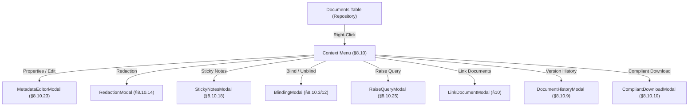

# Design: Sprint 1 — Document Context Action Modals (PDF §8.10)

## Context & Technical Approach
The eTMF 4.3 User Guide details 25 document context actions (§8.10). In the current frontend (`frontend/src/App.jsx`), several options (`checkout`, `view`) are wired, but others (`redact`, `notes`, `props`, `hist`, `blind`, `download`, `query`) invoke generic browser alert popups (`alert(...)`). 

This change introduces dedicated modular React modals within `frontend/src/components/document/` styled with the clean glassmorphic aesthetic defined in `frontend/src/index.css`.

## Proposed Architecture & Components

## Proposed Changes

### Component 1: `frontend/src/components/document/MetadataEditorModal.jsx` [NEW]
- Read/Edit document metadata: Document Title, Received Date, Effective Date, Expiry Date, Confidentiality Level, Mandatory flag, Description.
- Calls `PATCH /api/documents/:id/metadata`.

### Component 2: `frontend/src/components/document/RedactionModal.jsx` [NEW]
- Visual preview with interactive blackout boxes on canvas/mock.
- "Apply Redaction" confirmation dialog with permanent deletion warning per §8.10.14.
- Calls `PATCH /api/documents/:id/redact`.

### Component 3: `frontend/src/components/document/StickyNotesModal.jsx` [NEW]
- Author/reviewer notes list with role-targeting checkboxes: "Show to Reviewer", "Show to Approver", "Show to Viewer", "Show in all versions", "Note to file" per §8.10.18.
- Calls `POST /api/documents/:id/annotations` and `DELETE /api/documents/:id/annotations/:annId`.

### Component 4: `frontend/src/components/document/BlindingModal.jsx` [NEW]
- Blind or unblind toggle with mandatory reason and 21 CFR Part 11 confirmation.
- Calls `PATCH /api/documents/:id/blind`.

### Component 5: `frontend/src/components/document/RaiseQueryModal.jsx` [NEW]
- Select Query Type (Missing Document, Incorrect Version, Metadata Error, Content Issue).
- Severity dropdown (Critical, Major, Minor).
- Free-text query and assigned user selector.
- Calls `POST /api/queries`.

### Component 6: `frontend/src/components/document/LinkDocumentModal.jsx` [NEW]
- Browse folders on the left pane and documents on the right pane per User Guide §10.
- Link document, view existing links, unlink, and "Upgrade to latest version".
- Calls `POST /api/documents/:id/links` and `DELETE /api/documents/:id/links/:linkId`.

### Component 7: `frontend/src/components/document/DocumentHistoryModal.jsx` [NEW]
- Tabular version history (Major.Minor) showing check-in/out timestamps, user details, and rendition links per §8.10.9.
- Calls `GET /api/documents/:id/versions`.

### Component 8: `frontend/src/components/document/CompliantDownloadModal.jsx` [NEW]
- Radio button: "Revision Only" vs "All Content" per §8.10.10.
- Toggles for Cover Page, Revision History, Footer with Page Number, and Watermark.
- Download Types: Controlled Copy, Display Copy, Master Copy, Uncontrolled Copy.

### Component 9: `frontend/src/App.jsx` [MODIFY]
- Integrate the context modals into the right-click menu handler, dispatching state cleanly.

## Verification
1. Run automated backend integration tests: `npm test`
2. Compile frontend: `cd frontend; npm run build`
3. Trigger each of the 8 context actions from the UI and verify network responses (HTTP 200/201).
