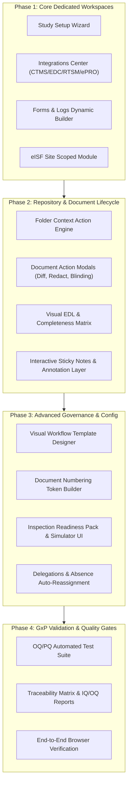

# eTMF Pro — Implementation Roadmap & Engineering Plan
**Regulatory Standard:** ICH E6(R2) | 21 CFR Part 11 | EU Annex 11 | ALCOA+ | DIA TMF Ref Model v3.2  
**Specification:** SRS-eTMF-COMBINED-001 (v4.0) | eTMF User Guide 4.3  
**Current Baseline:** 56 Implemented | 32 Partial / Stub | 15 Missing (103 Tracked Features)

---

## Architecture Overview

---

## Phased Implementation Breakdown

### Phase 1: Core Dedicated Workspaces
Focuses on the high-visibility missing modules identified in Section 1 of the audit:

1. **Study Setup & Configuration Wizard**
   - 4-step guided wizard: General Details (Protocol, Phase, Sponsor, Dates), Country & Regulatory Authority selection, Site Configuration with activation dates, and DIA Model version assignment with baseline summary.
   - Automatic triggering of EDL placeholder generation upon study creation.
   - Files: `frontend/src/components/study/StudyWizardModal.jsx`, `src/routes/studies.js`.

2. **Enterprise Integrations Center**
   - Unified status grid for CTMS, EDC, RTSM, ePRO, LMS, and RIM connectors.
   - Real-time connection health indicators (green/amber/red), last sync timestamp, records processed, and failure alerts.
   - On-demand "Sync Now" button triggering background synchronization.
   - Files: `frontend/src/components/integrations/IntegrationsDashboard.jsx`, `src/routes/admin.js`.

3. **Forms & Logs Interactive Workspace**
   - Schema selector (Investigator Site Visit Log, Delegation of Authority, Deviation Form).
   - Dynamic form renderer supporting date pickers, dropdowns, signatures, and file attachments.
   - Tabular entry viewer with export to CSV/PDF.
   - Files: `frontend/src/components/forms/FormsLogsWorkspace.jsx`, `src/routes/all-routes.js`.

4. **Electronic Investigator Site File (eISF)**
   - Site-scoped view filtering documents exclusively to the logged-in user's site.
   - Site readiness checklist and missing site document alerts.
   - Files: `frontend/src/components/eisf/SitePortalView.jsx`.

---

### Phase 2: Repository & Document Lifecycle
Elevates document actions (§8.10) and folder actions (§8.7–8.8) from basic alerts to fully interactive workflows:

1. **Complete Document Action Overlays**
   - `VersionDiffModal.jsx`: Side-by-side text/PDF visual comparison highlighting differences between versions.
   - `RedactionModal.jsx`: Visual blackout canvas tool updating the redacted asset and appending an audit record.
   - `MetadataEditorModal.jsx`: Form allowing authorized roles to update document title, effective date, expiry, owner, and custom fields.
   - `BlindingControlModal.jsx`: Role-gated blinding/unblinding with mandatory regulatory justification.
   - `StickyNotesOverlay.jsx`: Pin interactive annotations and QA queries directly to pages on the Document Viewer.

2. **Folder Context Action Engine**
   - Right-click menu for DIA zones/sections: Folder Lock/Unlock, Milestone Due Date setting, Group permission assignment, Folder export, and Folder history log.
   - Files: `frontend/src/components/repository/FolderContextMenu.jsx`, `src/routes/all-routes.js`.

3. **Visual Expected Document List (EDL) Matrix**
   - Heatmap/matrix display of Expected vs. Actual documents across Zone > Section > Artifact.
   - One-click "Mark N/A" modal with mandatory 21 CFR Part 11 justification text.
   - Export complete EDL to Excel/PDF.
   - Files: `frontend/src/components/edl/EDLMatrixView.jsx`, `src/routes/edl.js`.

---

### Phase 3: Advanced Governance & Configuration
Fulfills SRS Sections 5, 8, 12, 14, and 19:

1. **Visual Workflow Template Designer**
   - Visual builder for multi-step workflows: Single-step, Two-step (Reviewer -> Approver), and Multi-approver parallel tracks.
   - SLA duration configuration per step with escalation rules.
   - Files: `frontend/src/components/admin/WorkflowTemplateDesigner.jsx`.

2. **Document Numbering Token Builder**
   - Token pills: `[STUDY]`, `[ZONE]`, `[ARTIFACT]`, `[COUNTRY]`, `[YEAR]`, `[COUNTER:0001]`.
   - Drag-and-drop sequencing with real-time live preview (e.g. `TRIAL-01-TMF0101-US-2026-0001`).
   - Files: `frontend/src/components/admin/NumberingTokenBuilder.jsx`.

3. **Inspection Readiness Pack Builder & Q&A Simulator**
   - Real-time Inspection Readiness Scorecard (0–100%).
   - One-click Inspection Pack Generator (compiles selected zones/dates into an indexed zip/bundle).
   - Interactive Inspector Q&A Simulator querying AI endpoints with document citation links.
   - Files: `frontend/src/components/inspection/InspectionSimulator.jsx`, `src/routes/ai.js`.

4. **Task Delegation & Absence Auto-Reassignment**
   - Date-bounded delegation of review/approval tasks.
   - Automatic task reassignment when user is set to Absent.
   - Files: `frontend/src/components/admin/DelegationManager.jsx`.

---

### Phase 4: GxP Validation, Verification & Quality Gate

1. **OQ/PQ Automated Integration Suite**
   - Verification of full 9-state lifecycle state machine transitions.
   - E-signature re-authentication verification (21 CFR Part 11).
   - Role-based isolation across all 7 personas.
   - Audit trail immutability checks.

2. **Validation Traceability Matrix (VTM)**
   - Map all 103 requirements to automated test cases and manual verification procedures.

3. **End-to-End Build & Run Verification**
   - Clean production build: `npm run build`.
   - Automated test suite execution: `npm test`.

---

## Verification & Acceptance Criteria
- **Zero Console/Network Errors**: All actions return valid JSON and appropriate HTTP status codes (200/201/204).
- **ALCOA+ Audit Trail**: Every modification, deletion, blinding, or approval creates an immutable audit trail entry with user, role, IP, and timestamp.
- **21 CFR Part 11 Compliance**: Password re-authentication required on approval; no unauthenticated signing.
- **Cross-Browser Verification**: Verified across Chromium-based browsers, responsive layout with clean visual typography and zero layout shifts.
